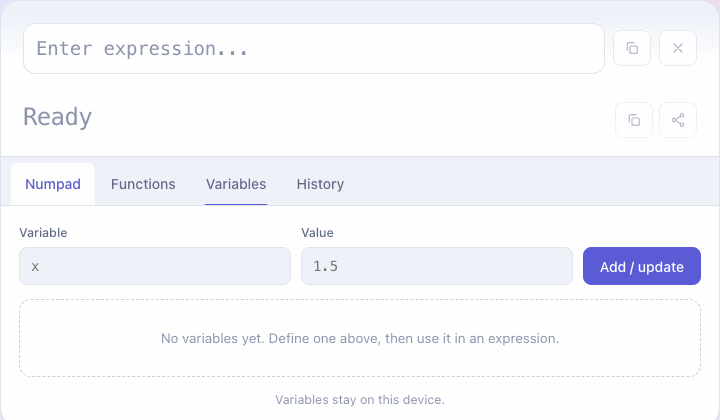

# Scratchpad Calculator

A scientific calculator. Expressions are evaluated by
[ExprTk](https://www.partow.net/programming/exprtk/) — the C++ library vendored in
`3rdPartyLib/exprtk` — compiled to WebAssembly and run in the browser. The front
end is TypeScript and React, bundled with webpack into static files.

Nothing is sent to a server: the wasm module, your variables and your history all
stay in the browser.

To build, run or deploy it yourself, see [docs/SETUP.md](docs/SETUP.md).

## Evaluating expressions

Type an expression into the box at the top. The result is recalculated on every
keystroke, so there is no **=** key. While the expression is incomplete or
wrong, the result line shows ExprTk's error and the position where it occurred.

Next to the expression and the result are buttons to:

- **copy** the expression or the result
- **clear** the expression
- **share**: copy a link that opens the calculator with this expression filled
  in

## Panels

| Tab           | What it does                                                                 |
| ------------- | ---------------------------------------------------------------------------- |
| **Numpad**    | Digits, operators and common functions for mouse or touch input; **x°** wraps a value in `deg2rad()` so trig functions can take degrees |
| **Functions** | Every operator, constant and function, searchable; click one to insert it   |
| **Variables** | Define named values such as `x = 1.5` and use them in expressions            |
| **History**   | Past calculations; load one back into the box or delete it                   |

**Variables.** If the expression uses a name that has no value yet, the
Variables tab lists it so you can define it. Changing a variable's value
recalculates the result straight away. Click a variable to insert it into the
expression.

**History.** Every valid expression is saved as you type. Shorter drafts that
the new expression contains are dropped, so typing `2+3*4` leaves one entry,
not five. **Add current** saves the expression as it is, even if it is invalid,
and keeps it until you delete it.

Variables and history are stored on this device only.

## Expression syntax

Anything ExprTk accepts, including:

- arithmetic and precedence — `1 + 2 * 3`, `2 ^ 3 ^ 2`
- functions — `sqrt`, `log10`, `hypot`, `clamp`, `ncdf`, and ~50 more
- constants — `pi`, `e`, `inf`, `epsilon`
- comparisons and logic — `3 > 2 and 1 < 2`
- conditionals — `if(x > 0, 1, -1)` and `x > 0 ? 1 : -1`
- your own variables, defined in the Variables tab

## Installing as an app

The calculator can be installed like a regular desktop or phone app. It then
opens in its own window, has its own icon, and works **completely offline**.

Open the calculator's `https://` address, wait until it shows a result, then
install it the way your browser does:

| Device and browser                  | Steps                                                                      |
| ----------------------------------- | -------------------------------------------------------------------------- |
| Chrome or Edge on Mac/Windows/Linux | **Install icon** at the right end of the address bar (a screen with a down arrow) → **Install**; or the **⋮** menu (Chrome) → **Cast, save, and share** → **Install page as app…** / the **…** menu (Edge) → **Apps** → **Install this site as an app** |
| Safari on macOS 14 or newer         | **File** → **Add to Dock…** → **Add**                                      |
| Safari on iPhone / iPad             | **Share** button (square with up arrow) → **Add to Home Screen** → **Add** |
| Chrome on Android                   | **⋮** menu → **Install app** (or **Add to Home screen**) → **Install**     |
| Firefox on desktop                  | Not supported; use one of the browsers above                               |

On a desktop, the app then appears in Launchpad / the Dock / Spotlight on macOS,
or the Start menu on Windows.

- **Updates:** when a new version is published, the installed app downloads it
  in the background the next time it is opened online, and uses it from the
  following launch.
- **Uninstall:** in Chrome/Edge, open the app → **⋮** / **…** menu →
  **Uninstall**. On macOS (Safari), drag it from `~/Applications` to the Trash.
  On a phone, remove it like any other app.

No install option, or want to install from your own machine without hosting
it? See [Serving it as an installable app](docs/SETUP.md#serving-it-as-an-installable-app-pwa).
